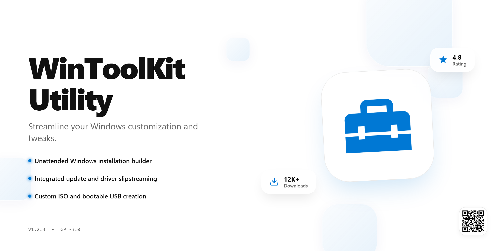

# WinToolKit Utility — Portable Suite for App Management & System Activation on Windows 10 & 11

### ⌨️ PowerShell Command Button

  

---

WinToolKit Utility is a portable Windows desktop that consolidates application deployment, built-in app removal, system information reporting, and Windows and Office activation into a single streamlined interface. Engineered for Windows 10 and 11, it operates directly from USB media, enabling consistent system provisioning and maintenance across multiple machines without permanent installation. The application exposes granular control over installed packages and host diagnostics, while its activation module integrates established licensing workflows for both operating system and productivity suites. An openly accessible, lightweight architecture keeps resource overhead minimal and ensures the remains immediately available whenever on-site configuration or troubleshooting is required.

## 📋 System Requirements

- Windows 10 or Windows 11
- PowerShell 5.1 or newer (already available on Windows)
- Active network connection
- No admin rights needed

## Features

**Portable Architecture** — The entire runs from a single directory with no installation footprint, making it suitable for USB deployment across multiple Windows 10 and 11 systems.

- **Application Deployment Module** — Launch installers from a user-maintained collection organized within the 's application directory, enabling consistent software provisioning during system setup.

- **Application Removal Module** — Selectively uninstall built-in Windows components through a guided interface that presents available packages and executes removal operations.

- **System Information Viewer** — Query hardware and operating system details from a consolidated panel for inventory, diagnostics, or troubleshooting workflows.

- **Windows and Office Activation Access** — Provides a direct entry point to Microsoft Activation Scripts for license provisioning on supported Windows and Office installations.

- **Activity Logging** — Persist operational records to disk for post-session review, audit, and fault isolation when a module does not behave as expected.

- **Unified Menu Interface** — Navigate all modules from a single console menu, reducing the need to locate and invoke individual utilities manually.

- **Elevation-Aware Launch** — A dedicated launcher requests administrator privileges at startup so that operations requiring elevated context proceed without interruption.

## How It Works

WinToolKit Utility is built around a single, self-contained executable that orchestrates all of its functions through a unified menu-driven interface. Rather than scattering tasks across separate utilities, the application routes every operation — installation, removal, diagnostics, and activation — through one central controller, keeping behavior consistent and predictable across sessions.

**Portable execution model**

WinToolKit Utility runs entirely from its own directory. It does not write dependencies to system-wide locations or require a background service. All supporting files, configuration data, and logs remain alongside the executable, which allows the to be carried on removable media and launched on any compatible Windows 10 or Windows 11 system. Administrator elevation is requested only when an operation requires it, and the application validates its environment before executing privileged tasks.

**Application installation pipeline**

The installation module scans the bundled application directory, enumerates supported installer formats, and presents them as a selectable list. When an entry is chosen, WinToolKit Utility resolves the installer path, verifies file integrity, and launches the package with the appropriate parameters. The module tracks each invocation and records outcomes to the session log, so multi-app deployment sequences remain auditable. Because the catalog is user-managed, the imposes no fixed application list — the pipeline simply reflects whatever installers are present.

**Application removal workflow**

The removal module queries the operating system for installed packages and built-in components, then exposes them through a filtered selection interface. Each removal request is confirmed before execution, and the module reports per-item success or failure rather than aborting the entire batch. Dependency checks warn when a targeted component is referenced by other installed software, giving the operator a chance to revise the selection before changes are committed.

**System information collection**

The diagnostics module aggregates hardware and software details — operating system build, processor and memory configuration, storage layout, and installed component inventory — into a single consolidated view. Data is collected through native system interfaces, requiring no external agents, and can be exported for reference or troubleshooting. This gives operators a fast, read-only snapshot of a machine's state before or after maintenance work.

**Activation module**

The activation module provides a guided entry point for Windows and Office licensing operations. It presents the available activation pathways, verifies prerequisite conditions such as connectivity and elevation, and hands off execution to the underlying activation routine. Progress and results are surfaced in the interface and mirrored to the log for later review.

**Logging and traceability**

Every module writes structured entries to a session log stored within the directory. Log records include timestamps, operation identifiers, and outcome states, enabling operators to reconstruct exactly what the did on a given machine. The log viewer inside the application reads these files directly, so no separate tooling is needed to inspect activity.

**Menu orchestration**

The main interface acts as the coordination layer: it initializes the environment, checks permissions, loads module definitions, and dispatches the selected operation. Modules are isolated from one another, so a failure in one workflow does not disrupt the others. This architecture keeps the resilient, easy to extend, and straightforward to operate from either a local disk or a USB drive.

## Compatibility

WinToolKit Utility is engineered for deployment across Windows 10 and Windows 11 environments, including systems running the latest cumulative updates and feature releases. The operates without requiring a permanent installation, executing directly from local storage or removable media such as USB drives.

Administrative privileges are required for features that modify system state, including app removal and activation workflows. PowerShell execution must be enabled on the host system; the relies on built-in Windows PowerShell components and does not introduce external runtime dependencies.

Network connectivity is required for online operations, including activation scripts and any features that retrieve content from remote sources. Offline functionality remains available for local tasks such as launching bundled installers from the Apps directory and viewing system information.

The maintains compatibility with both 32-bit and 64-bit Windows architectures, though 64-bit systems are recommended for full feature access. Systems with restricted execution policies may require policy adjustments prior to launch. WinToolKit Utility does not modify system files persistently and leaves no residual installation footprint, making it suitable for portable use across multiple compatible machines.

## FAQ

**Is WinToolKit suitable for deployment across multiple workstations?**

Yes. WinToolKit is designed as a portable utility that runs from local storage without a formal installation footprint. Place the directory on removable media or a shared drive, launch it with administrative elevation on each target system, and the same menu-driven interface is available immediately. This makes it appropriate for technicians who provision or maintain several Windows 10 and Windows 11 machines in sequence.

**Which components require administrative elevation?**

App installation, app removal, activation operations, and system information queries all interact with protected areas of the operating system. Launch WinToolKit through the provided elevation entry point so that these features can execute with the required privileges. Running without elevation will limit or block features that modify system state.

**How does the custom application installer locate my packages?**

WinToolKit reads from the `Apps` directory inside the folder. Place supported installer files or application folders there, then select **Install Custom Apps** from the menu. The enumerates what it finds and launches the chosen installer. Because the collection is user-supplied, the contents and validity of each package remain the responsibility of the operator.

**Does WinToolKit bundle application installers or activation components?**

No. The provides the orchestration layer and menu interface; it does not ship third-party application packages. Activation functionality is delivered through Microsoft Activation Scripts as a separate project, invoked from within the. An internet connection may be needed for scripts that retrieve components at runtime.

**What happens to Windows functionality after built-in apps are removed?**

Removing provisioned Microsoft apps reduces the default application surface, which is useful when preparing lean images. Some removals can affect features or dependent software that expect those apps to be present. Review each selection before confirming, and validate the resulting system against your intended workload.

**Where can I inspect activity and diagnose unexpected behavior?**

Select the **Logs** option from the main menu to open the 's log directory. Logs record operations performed by supported features and are the first place to check when a step does not complete as expected. Pair this with **System Information** to capture the OS build, architecture, and related details when reporting an issue.

**Can WinToolKit run entirely from a USB stick?**

Yes. The is built for removable-media use. Keep the elevation entry point, the main script, and supporting files together in the same directory structure on the USB device. Copying individual files out of the folder will break relative path resolution and cause features to fail.

**Which Windows versions are supported?**

WinToolKit targets Windows 10 and Windows 11 with Windows PowerShell available. Administrator permissions are required for features that change system state, and an internet connection is required for operations that fetch online content.

## Disclaimer

WinToolKit Utility is provided as a portable administrative for compatible Windows 10 and Windows 11 systems. It is intended for use by users who understand Windows system administration and who hold the appropriate authority over the machines on which it is run.

The performs real, system-level operations — application installation from user-supplied installers, removal of selected built-in Microsoft apps, retrieval of system information, and access to Windows and Office activation resources. These operations modify system state. You are responsible for reviewing every selection before you confirm it, and for maintaining current backups of important data and system configurations.

Activation functionality is delivered through a separate, independently maintained project. WinToolKit Utility does not itself generate, issue, or validate licences. Use activation methods only where they correspond to your genuine software entitlement and comply with the applicable licence terms.

Removal of built-in apps may affect Windows features or other software that depends on them. Installer compatibility depends on the format and folder structure of the files you supply; the project does not ship third-party installers and cannot guarantee the behaviour of software obtained elsewhere. Obtain installers only from trusted sources.

The project is offered on an "as is" basis, without warranties of any kind, express or implied, including fitness for a particular purpose or non-infringement. To the maximum extent permitted by applicable law, the authors and contributors accept no liability for data loss, system instability, activation status changes, or other damages arising from use of the. Run it at your own discretion, and test in a controlled environment before deploying to production or shared hardware.

## License

WinToolKit Utility is distributed under a permissive, source-available license that grants you the right to inspect, modify, and redistribute the software in both its original and derivative forms. You may deploy the across any number of Windows 10 and Windows 11 systems, embed it within your own portable workflows, and adapt its PowerShell modules to suit your environment.

Redistribution of the compiled launcher or its supporting scripts, whether in original or modified condition, is permitted provided that the original attribution to the WinToolKit Utility project is retained and any substantive changes are documented. Redistributed copies must include this license statement in full.

The software is provided on an "as is" basis, without warranty of any kind, express or implied, including but not limited to the implied warranties of merchantability, fitness for a particular purpose, and non-infringement. In no event shall the authors or copyright holders be liable for any claim, damages, or other liability, whether in an action of contract, tort, or otherwise, arising from, out of, or in connection with the software or the use or other dealings in the software.

You remain solely responsible for ensuring that your use of WinToolKit Utility, including its activation and app-removal features, complies with all applicable software licensing terms and entitlements. The itself does not grant any rights to third-party software, and any activation functionality operates on separate, independently licensed components.

Modifications that alter the behavior of the app-removal or activation modules must clearly disclose those changes in any redistributed version. The WinToolKit Utility name and project attribution may not be used to endorse or promote modified variants without prior written consent.